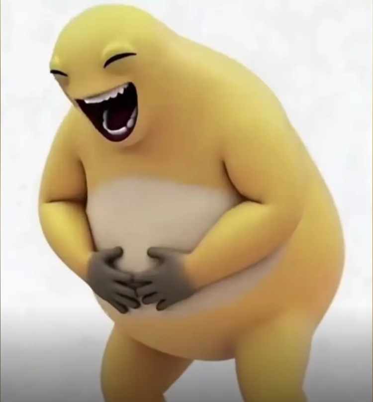

# 奶蛙bench · nai-wai-bench

[English](README.md) | [简体中文](README.zh-CN.md) | 繁體中文

一個測試 AI 模型對中文網絡迷因 **大笑奶龍**（又稱 **奶蛙**）了解程度的基準：AI 生成的「變異」奶龍，彎腰捧腹、狂笑不止。



**結果：**[wusitee.github.io/nai-wai-bench](https://wusitee.github.io/nai-wai-bench/)（0.1.0 版：
附 95% 自助法區間與名次範圍）。

基準發佈兩個看圖理解排名，並合成為**奶蛙指數 · NaiWai Index**：

1. **識梗 Meme ID**（`--suite core`，13 道看圖題）：認出這個迷因及其變體，說出名稱和別名，區分官方形象圖。
   9 道自由回答由 LLM 評審評分，4 道姿勢與眼睛核對題按固定答案鍵計分。
2. **看圖 Visual detail**（`--suite naihub-v1`，24 張圖）：回答類別、數量、姿態、眼睛、嘴巴、手勢和眼淚，
   在本地與答案鍵比對。七項全部答對，這張圖才算答對。

指數是兩項得分的加權平均（識梗 1/3、看圖 2/3），只有兩項都有名次的模型才進入指數。
純文字的來龍去脈、憑記憶描述畫面以及中英文提示詞撰寫只作診斷，不進入任何排名。
只有完整跑完固定題組的模型才會獲得暫定名次。不完整的結果仍會顯示，並標明完成的格數。
幾分的差距不足以證明排序可靠。

**圖像生成**是不計入指數的實驗項目：圖像模型按五檔提示詞（中文名稱、英文名稱、簡略描述、
詳細描述其 3D 外觀、參考原圖）把這個迷因畫成其他動物。另有一個不計分的可選題組，測試能否把奶蛙的
其他表情（憤怒、扶額、得意）遷移到別的動物身上。

預設由 Claude Opus 5.5 評審自由作答和生成圖片；按答案鍵計分的題目在本地計分。報告只統計已設定的評審，
除非用 `--judges` 另行指定。

## 快速開始

環境要求：Python 3.12+、[uv](https://docs.astral.sh/uv/)，以及至少一個已登入的 Agent CLI 或 API 密鑰：
[Codex](https://github.com/openai/codex)（OpenAI 模型與圖像生成）、
[Claude Code](https://claude.com/claude-code)（Anthropic 模型，或其他供應商的 Anthropic 相容介面）、
[pi](https://github.com/earendil-works/pi)（pi 支援的任何供應商）、
ACP Agent（如 DeepSeek Harness、Kimi Code、Antigravity），
或 OpenAI 相容 API（如小米 MiMo，密鑰來自環境變數或 [CC Switch](https://github.com/farion1231/cc-switch)）。
收集結果不需要評審模型；沒有評審權限的協作者可以分享結果，交由他人評審（見
[Contributing results](docs/contributing-results.md)）。

```sh
uv sync
uv run nwb list                                   # 查看模型、題目、提示詞檔位和動物

# 理解：看圖題，以及文字診斷題和無圖對照
uv run nwb understand --models opus-5.5,gpt-6.1-sol,deepseek-v4-pro,mimo-v2.6-pro
# 圖像生成：6 種動物 × 5 檔 = 每個模型 30 張圖
uv run nwb imagegen --models chatgpt-image --animals default

uv run nwb judge                                  # 使用 models.toml 中的預設評審（需要 Claude Code）
uv run nwb report                                 # 產生 runs/main/report.html
uv run nwb site                                   # 寫入 site/index.html
```

結果儲存在 `runs/<run>/`（`--run NAME`，預設 `main`）。中斷的執行會接著跑，失敗的樣本會自動重試。

## 文件

- [基準設計](docs/design.zh-Hant.md)：題目、檔位、評分標準、計分方式、結果網站和結果目錄結構
- [評測方法](docs/methodology.zh-Hant.md)：研究依據、呼叫預算、對照設計和局限
- [可選的表情遷移](docs/design.zh-Hant.md#可選的表情遷移)：把憤怒、扶額、得意三種表情遷移到貓和青蛙身上，
  每個圖像模型 12 張圖；另有表情提取題，均不使用 LLM 評分
- [後端與模型](docs/backends.zh-Hant.md)：各 Agent CLI 的呼叫與隔離方式，以及如何新增模型（包括 pi 和透過
  Claude Code 接入的其他供應商）
- [Contributing results](docs/contributing-results.md)（英文）：沒有評審權限時如何收集、分享結果，以及如何評審分享來的結果
- [素材來源](bench/reference/SOURCE.md)：參考圖、表情包和事實的出處

參考圖和表情包僅供非商業研究使用。
