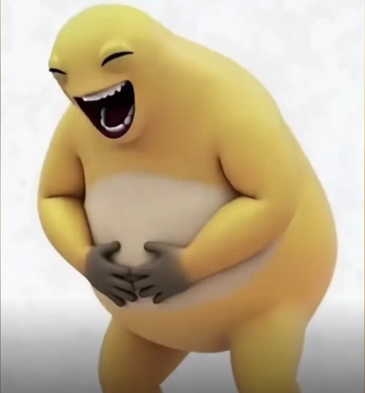

# nai-wai-bench

[English](README.md) | [简体中文](README.zh-CN.md) | 繁體中文

一個測試 AI 模型對中文網絡迷因 **大笑奶龍**（又稱 **奶蛙**）理解程度的基準：AI 生成的「變異」奶龍，彎腰捧腹、狂笑不止。



基準分為兩部分：

1. **理解**：文字模型和視覺模型講解這個迷因的來源和相關梗、憑記憶描述它的樣子、為它撰寫圖像生成提示詞，
   並從圖片中認出它。回答會對照有出處的事實評分，言之鑿鑿的幻覺會被扣分。
2. **圖像生成**：圖像模型把這個迷因畫成其他動物（貓、長頸鹿、章魚等），提示詞分四檔：中文名稱、英文名稱、
   完整的外觀描述、參考原圖。比較「只給名稱」和「給出描述」的結果，就能看出模型是真的認識這個迷因，
   還是只有被告知長相時才畫得出來。

每個樣本都由多家廠商的評審模型評分；只要有其他廠商的評審可用，模型就不會由同廠商的評審評分。

## 快速開始

環境要求：Python 3.12+、[uv](https://docs.astral.sh/uv/)，以及至少一個已登入的 Agent CLI 或 API 密鑰：
[Codex](https://github.com/openai/codex)（OpenAI 模型與圖像生成）、
[Claude Code](https://claude.com/claude-code)、ACP Agent（如 DeepSeek Harness、Kimi Code、Antigravity），
或 OpenAI 相容 API（如小米 MiMo，密鑰來自環境變數或 [CC Switch](https://github.com/farion1231/cc-switch)）。

```sh
uv sync
uv run nwb list                                   # 查看模型、題目、提示詞檔位和動物

# 第一部分：向模型提問，再評審回答
uv run nwb understand --models opus-5.5,gpt-6.1-sol,deepseek-v4-pro,mimo-v2.6-pro
# 第二部分：以全部檔位繪畫預設的動物子集
uv run nwb imagegen --models chatgpt-image --animals default

uv run nwb judge                                  # 使用 models.toml 中的預設評審
uv run nwb report                                 # 產生 runs/main/report.html
```

結果儲存在 `runs/<run>/`（`--run NAME`，預設 `main`）。中斷的執行會接續進行，失敗的樣本會自動重試。

## 文件（英文）

- [基準設計](docs/design.md)：題目、檔位、評分準則、計分方式和結果目錄結構
- [後端與模型](docs/backends.md)：各 Agent CLI 的呼叫與隔離方式，以及如何新增模型
