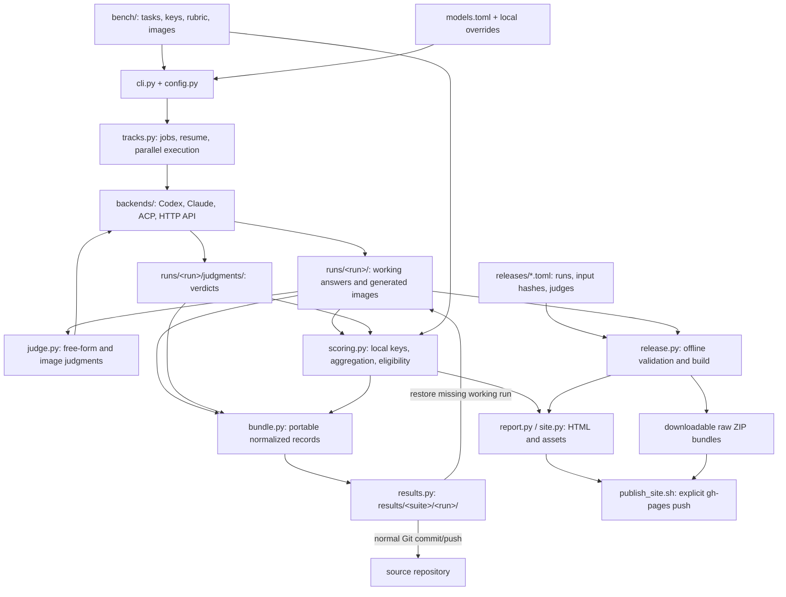

# Architecture

[Open the interactive architecture board](architecture.html).

nai-wai-bench is a file-based Python CLI. Benchmark definitions, model settings, working observations,
portable results, and generated publications have separate roles.

## Collection and backends

`cli.py` selects suites, items, tiers, animals, models, and repetitions. `config.py` loads the task files
and model registry, validates fixtures, and fingerprints collection settings. `tracks.py` creates jobs
and runs them through a thread pool. Each result is written atomically; successful jobs are reused only
when their recorded identity matches. Errors remain recorded for retry.
The whole batch is checked before requests: a successful record with different settings requires a
new run or explicit `--force`. A no-op writes no collection log and does not refresh snapshots.

The backends share `Request` and `Response`. Codex and Claude drive their logged-in CLIs; ACP drives
configured agents such as DeepSeek Harness, Kimi, and Antigravity; the OpenAI-compatible backend uses
HTTP directly. CLI/ACP calls use temporary working directories, attachments receive neutral names, and
understanding calls disable or reject tools and record attempted tool use. Generated images have a
separate verbatim-prompt audit. Usage, timing, effective settings, collection revision, and available
vendor image provenance are retained with the observations.

## Scoring paths

| Panel | Inputs | Scoring | Ranking |
|---|---|---|---|
| Core understanding | 13 visual tasks, eight text diagnostics, four blind controls | Nine visual recognition tasks use LLM judges; four visual grounding tasks use local keys | Equal item weight across the 13 visual tasks |
| Nai-hub understanding | 24 visual tasks and 24 blind controls | Seven fields per image, scored locally | All seven fields correct earns 100; otherwise 0, averaged by image |
| Standard generation | Six default animals × five tiers | LLM judges rate weighted style traits and target-animal identity | 30-cell panel; overall = style × identity / 2 |
| Optional state transfer | Core: three sources; Nai-hub: eight sources | Extraction uses local keys; generated transfers are unscored | Separate diagnostics and galleries |

`judge.py` sends free-form answers or generated images to configured judges through the same backends.
`scoring.py` performs local grading and aggregates the recorded judgments without model calls. Judges
from other vendors take precedence, with a fallback to available judges when none are independent.

Only complete, balanced panels with homogeneous recorded settings receive ranks. Freshness checks
cover subject prompts, target content or legacy timestamps, current judge prompts, and visual evidence
paths. Tool-contaminated answers are excluded. Generation ranking requires verified verbatim prompts;
verified provider refusals count as zero. Text answers, blind controls, and optional state tasks remain
diagnostics. The two rankings have no combined score.

Reports also expose contributing judges, coverage, paired cluster-bootstrap intervals, repetition
consistency, and usage/price diagnostics. The methodology describes their limits.
Recorded Codex `legacy-v1` and `isolated-v1` collector profiles are shown per row and in collection
metadata. The retained comparison mixes these profiles, so observed model differences are confounded
with collector configuration; see [release conditions](releases.md#selected-comparison).

## Storage and publication

| Location | Role | Git behavior |
|---|---|---|
| `bench/`, `models.toml`, `src/` | Definitions, configured models, implementation | Tracked |
| `runs/<run>/` | Resumable working observations, judgments, and local reports | Ignored |
| `results/<suite>/<run>/` | Sanitized portable observations, generated images, scores, and checksum metadata | Included in normal source commits |
| `releases/*.toml` | Explicit comparison selection and normalized input pins | Tracked |
| `site/` or `--out` | Generated pages, assets, scores, bundles, and build metadata | Default output ignored |
| `models.local.toml` | Local settings and credential references | Ignored |

Collection, judging, and reporting refresh `results/` unless `--no-sync` is set. The snapshot and ZIP
export share the same normalization logic. Restoration checks file hashes and suite membership, and
fills a missing working run; existing working runs take precedence. Saving results updates files for
the normal Git workflow. The benchmark does not issue Git commits or pushes during collection.

`release.py` restores missing selected runs, validates the manifest's version, input hashes and judge
selection, and rejects stale judgments before producing both suite pages and raw bundles. Publishing
is a separate explicit invocation of `scripts/publish_site.sh`, which builds into a fresh directory
and replaces `gh-pages`. See [release operations](releases.md) and [scoring details](design.md).
